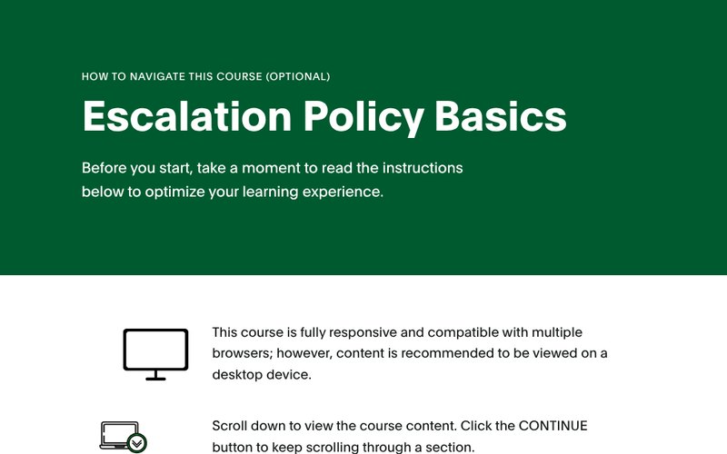
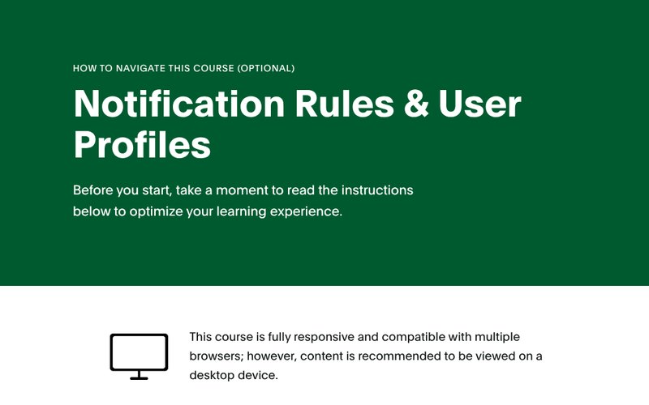
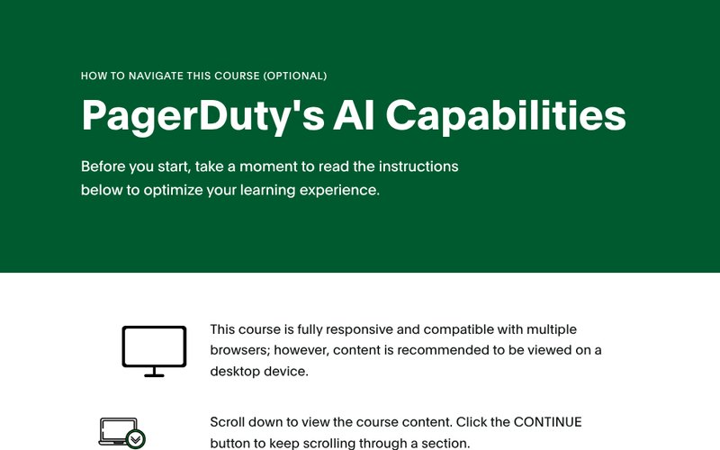
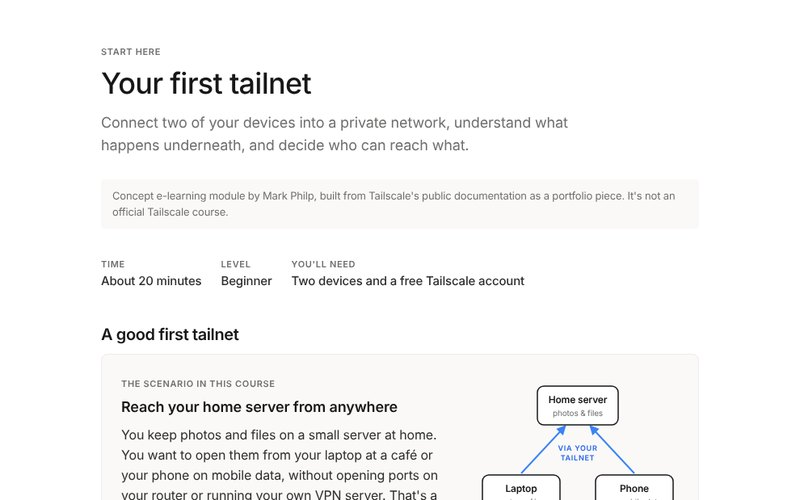

I build self-paced e-learning courses that teach people how to set up and get the most out of PagerDuty. Each course is fully interactive and opens full screen in a new tab.

<svg viewBox="0 0 24 24" width="26" height="26" fill="none" stroke="#36677a" stroke-width="1.8" stroke-linecap="round" stroke-linejoin="round" aria-hidden="true"><rect x="3" y="4" width="18" height="12" rx="2"/><path d="M2 20h20"/></svg>
<strong>Best on a computer.</strong> These interactive courses are built for a larger screen. On a phone they won’t display the way they’re meant to, so open them on a desktop or laptop for the full experience.

### Escalation Policy Basics

  
  

    
Escalation policies decide who gets notified, in what order, and what happens when nobody answers. This course covers how incidents move through escalation levels, how to choose targets and set timeouts, how to plan on-call handoffs, and which common anti-patterns to avoid.

    <a class="course-open" href="../elearning/escalation-policy-basics/" target="_blank" rel="noopener">Open the course ↗</a>
  

---

### Notification Rules & User Profiles

  
  

    
When an incident is assigned to you, your user profile decides how and when PagerDuty reaches you. This course walks through each profile tab, adding and testing contact methods, configuring notification rules for high- and low-urgency incidents, and managing account settings.

    <a class="course-open" href="../elearning/notification-rules-user-profiles/" target="_blank" rel="noopener">Open the course ↗</a>
  

---

### PagerDuty's AI Capabilities

  
  

    
An introduction to the generative and agentic AI built into the PagerDuty platform: the PagerDuty Assistant, the four AI agents, Paige the SRE Agent in action, and how these capabilities are enabled and governed.

    <a class="course-open" href="../elearning/pagerduty-ai/" target="_blank" rel="noopener">Open the course ↗</a>
  

---

### Your First Tailnet (concept course for Tailscale)

  
  

    
A self-initiated concept course, built from Tailscale's public docs to show how I'd approach their learning content. It covers what a tailnet is, how devices find each other, direct versus relayed connections, a hands-on setup, and access rules with grants. Includes a design system based on Tailscale's look and a diagram style guide. Not an official Tailscale course.

    <a class="course-open" href="../elearning/your-first-tailnet/" target="_blank" rel="noopener">Open the course ↗</a>
  

